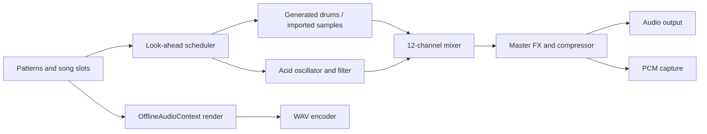

# RAVE GENERATOR 2 — Studio Niko Design

**A browser-native acid groovebox with synthesized drums, a 12-channel mixer and real PCM audio export.**

Une groovebox de création rave et acid : 11 percussions synthétisées, une basse monophonique et un véritable moteur d'export audio local.

   

**STUDIO NIKO DESIGN** · Build smart. Stay lightweight. Create without limits.

[English overview](#english-overview) · [Démarrage rapide](#quickstart--démarrage-rapide) · [Issues](https://github.com/Nikoju1977/Rave-Generator-2/issues)

> **À essayer en premier :** programmer un groove acid, enregistrer le master avec REC WAV puis comparer le fichier obtenu avec un EXPORT WAV hors ligne. Aucun compte externe n'est nécessaire pour ces deux opérations.

## Parcours de validation reproductible / Reproducible audio check

Procédure proposée, **non exécutée pour cette révision**. Relever le navigateur, l'OS, la fréquence d'échantillonnage et la version Git avant chaque essai.

| Essai | Résultat attendu et preuve à conserver |
| --- | --- |
| Transport | PLAY, changements de BPM et pattern A–H ; lecture audible, sans décrochage perceptible pendant l'essai |
| Mixage | Tester mute/solo et panoramique ; vérifier séparément les canaux gauche/droit |
| REC WAV | Enregistrer 20 s ; fichier RIFF/WAVE stéréo PCM 16 bits, fréquence du contexte audio |
| EXPORT WAV | Exporter 4 mesures ; fichier PCM stéréo 44,1 kHz/16 bits avec signal non nul |
| Sauvegarde | Exporter JSON, modifier le pattern, restaurer après confirmation ; vérifier le retour à l'état initial |
| Import défectueux | Charger un JSON invalide ; vérifier que le projet précédent reste intact |

Les deux WAV ne sont pas nécessairement identiques échantillon par échantillon : la capture en direct et le rendu hors ligne utilisent des chemins distincts. La présence d'un signal non nul ne démontre pas l'absence de distorsion ou de coupures. Ne pas assimiler le format PCM 16 bits à un mastering certifié.

**English:** Record a short live master WAV and render a separate offline WAV; check their headers, channel balance, duration and audible continuity. Keep the browser/device and commit details with the results. This is a proposed manual checklist, not a new test report.

## Pourquoi ce projet ?

Transformer le navigateur en instrument immédiatement jouable. Le moteur natif synthétise les percussions à partir de formes d'onde et de bruit pseudo-aléatoire ; le scheduler anticipe les événements sur l'horloge audio. Cette architecture limite les dépendances et évite le téléchargement d'une banque de samples.

## Fonctionnalités clés

- 🥁 11 pistes de percussion et basse acid (accent, slide, filtre résonnant).
- 🎛️ 8 patterns A–H de 16/32 pas, 60–230 BPM, swing, arrangement Song à huit slots.
- 🔊 Mixeur 12 voies, panoramique, mute/solo, saturation, filtre, delay, reverb et compresseur.
- 💿 Capture master PCM stéréo 16 bits à la fréquence native du contexte audio (8 minutes maximum) ; rendu hors ligne stéréo 44,1 kHz/16 bits de 4 à 32 mesures.
- 🎼 MIDI type 1, import de samples jusqu'à 15 Mo, sauvegarde JSON et restauration confirmée.

## Architecture & sécurité

Le moteur est embarqué dans `index.html` : `makeDrumBuffer` génère les percussions, `bassHit` construit la voix acid, `schedule` alimente l'horloge Web Audio et `createAudio` organise le graphe. La capture privilégie AudioWorklet, avec repli ScriptProcessor ; `exportWav` utilise OfflineAudioContext, distinct de la capture temps réel. L'import décode les samples avant remplacement de l'état. Aucun framework ni bibliothèque audio externe n'est requis par le fichier principal inspecté ; le partage Suno ouvre seulement un service externe, sans upload automatique. Le stockage local et les exports JSON ne sont pas chiffrés. Ne pas partager d'échantillons sans droits.

**Preuves :** inspection du code source et des documents sur GitHub. Aucun test audio, benchmark, écoute ni validation de production nouvelle lors de cette révision documentaire. Les contrôles antérieurs rapportés ci-dessous ne prouvent pas la stabilité actuelle sur appareils physiques.

## Quickstart / Démarrage rapide

Ouvrir `index.html` ou servir le dépôt avec `python3 -m http.server 8000`, puis http://localhost:8000/. Appuyer sur PLAY pour autoriser l'audio. Pour la PWA utiliser HTTPS ou localhost. Les contrôles `node tests/check.cjs` et `node tests/browser-smoke.cjs` sont disponibles (ce dernier nécessite Chromium et son environnement de test).

## Documentation technique et historique

Groovebox inspirée du son TR-909 et synthé acid, entièrement en HTML/CSS/JavaScript avec Web Audio API. Sans clé API, sans dépendance audio et sans échantillon tiers.

## Démarrer

1. Ouvrir `index.html` dans un navigateur compatible (Chrome, Edge, Firefox). Sur Android, privilégier une installation PWA depuis une adresse HTTPS.
2. Cliquer sur **PLAY** : le navigateur autorise alors Web Audio.
3. Éditer les 11 pistes de percussion, la basse acid, le tempo (60–230 BPM), le swing et les patterns 16/32 pas A–H.
4. Utiliser le **mixer 12 voies**, les volumes, mute/solo, panoramique, tuning, decay, distorsion, filtre, delay, reverb, compresseur et le mode Song à huit slots.
5. Importer des samples WAV/MP3/OGG selon le décodage du navigateur (15 Mo par fichier), ou sauvegarder un projet JSON.

## Enregistrer en WAV — nouveauté corrigée

**REC WAV** démarre la capture réelle de la sortie master (mix batterie + basse acid + effets). Si la lecture n'est pas active, elle démarre automatiquement. **STOP WAV** crée et télécharge un fichier **.wav PCM stéréo 16 bits**, à la fréquence native de l'AudioContext (44,1 kHz ou 48 kHz selon l'appareil). L'enregistrement ne capture pas le micro. Limite de protection mémoire : 8 minutes.

**EXPORT WAV** rend une séquence de 4, 8, 16 ou 32 mesures dans un fichier WAV PCM **44,1 kHz / 16 bits stéréo**, sans attendre la lecture temps réel. Le rendu suit le pattern courant ou le mode Song.

**PARTAGER WAV** utilise la feuille de partage du système si elle est disponible (notamment Android) ; le bouton devient actif après un export/enregistrement. Si le partage de fichier est indisponible, utilisez le fichier enregistré dans **Téléchargements**.

**SUNO** ouvre uniquement https://suno.com/create : pour importer le son dans Suno, sélectionner **Upload Audio / Importer l'audio**, choisir le fichier WAV. Il n'y a **pas d'envoi automatique**, ni de connexion Suno, ni d'API privée intégrée.

## Autres exports

- MIDI de type 1, une piste tempo et 12 pistes d'instruments.
- Export et import de projet JSON avec intégration facultative des samples.
- Sauvegarde automatique en `localStorage` si autorisée par le navigateur.

## PWA et mise à jour

Héberger en HTTPS les fichiers `index.html`, `sw.js`, `manifest.webmanifest` et `icon.svg` sur un serveur statique (GitHub Pages, Vercel, etc.). Le Service Worker a une nouvelle version de cache pour invalider les anciens fichiers et privilégier les mises à jour HTML en ligne avec secours hors ligne.

Le fichier principal autonome est `index.html`. L'ancien fichier `Rave-Generator-2.html` n'a pas été retrouvé à la racine de `main` lors de cette inspection ; utiliser `index.html`.

## Compatibilité et vérification

- Fonctions audio basées sur Web Audio API ; l'enregistrement en direct privilégie AudioWorklet, avec repli ScriptProcessor sur les environnements plus anciens/restrictifs.
- Tests automatisés Chromium effectués sur le DOM, la synthèse, l'enregistrement PCM direct et le rendu WAV hors ligne ; vérification des en-têtes RIFF, de la stéréo, de la résolution et de la présence d'audio non silencieux.
- Les téléchargements réels, le partage vers Suno et le comportement sur un téléphone Android physique n'ont pas été testés dans un navigateur réel associé à un appareil ou un compte Suno.

**Marques :** logiciel indépendant de Roland, inspirations fonctionnelles et sonores uniquement.
## Lot de fiabilisation du 22 novembre 2026 — restauration sans perte et WAV

- L'import d'un projet JSON demande désormais une **confirmation explicite** avant de remplacer les patterns, réglages et samples. Un refus ne modifie pas le projet actuel.
- Les éventuels samples joints sont intégralement préparés et décodés **avant** toute substitution des données ; en cas de sample corrompu, le projet actuel est conservé et l'import est refusé, plutôt que de perdre silencieusement les prises précédentes.
- Le bouton d'import est désactivé pendant la préparation des samples pour empêcher deux imports concurrents.
- La CI `tests/check.cjs` valide le code et la présence des protections. `tests/browser-smoke.cjs` vérifie dans Chromium une annulation d'import, une restauration et **le contenu PCM d'un rendu WAV stéréo 44,1 kHz, 16 bits avec signal non nul**.
- Cette validation automatisée ne vaut ni essai sur iPhone/Android physique ni garantie d'enregistrement temps réel, de partage Suno ou de qualité sonore professionnelle.

## Roadmap & contribution

Propositions non terminées :

- [ ] Vérifier l'enregistrement temps réel sur appareils physiques Android/iOS.
- [ ] Mesurer les dropouts, le jitter du scheduler et la consommation mémoire pendant une session longue.
- [ ] Tester les exports WAV/MIDI dans un DAW et les imports de samples corrompus.
- [ ] Documenter les variations de fréquence d'échantillonnage et le partage natif.

**Première contribution / `good first issue` (label proposé, non créé ici) :** Fournir un scénario de reproduction d'un problème de WAV ou de restauration avec un projet JSON non sensible. Les retours sont bienvenus dans les [issues](https://github.com/Nikoju1977/Rave-Generator-2/issues), sous réserve des droits existants. Ne pas partager de données ou sons privés.

## English overview

Rave Generator 2 is a native Web Audio groovebox with 11 synthesized drum tracks, an acid bass voice, eight patterns and a 12-channel mixer. It records the master to PCM WAV and separately renders offline stereo 44.1 kHz WAV. MIDI and JSON export are implemented. No external audio library is required by the inspected main HTML. Run index.html or serve it over localhost, then click PLAY. Browser-specific recording and downloads need physical-device verification. No fresh runtime test or performance benchmark was run during this documentation revision. Feedback and reproducible issue reports are welcome; respect the existing rights notice.

## Licence & auteur / License & author

**© 2026 Studio Niko Design — [Nikoju1977](https://github.com/Nikoju1977).** [Notice de droits d'auteur](LICENSE.md) : tous droits réservés pour les contributions originales concernées. La publication du code n'accorde pas de licence Open Source ; les contributions et redistributions restent soumises aux droits existants. Aucun fichier de licence n'est modifié.
